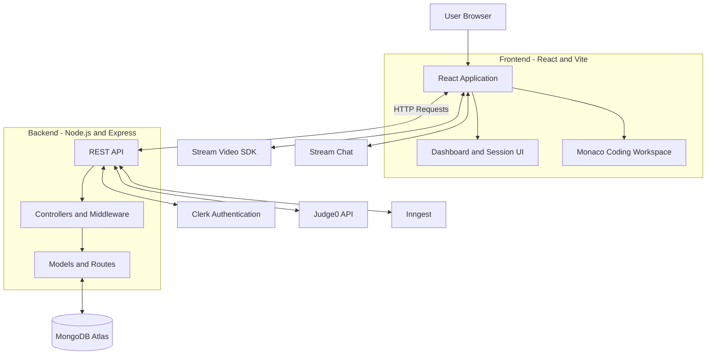

# Talent-IQ – Remote Interview Platform

<p align="center">
  A full-stack remote interview platform for conducting technical interviews with real-time video communication, chat, and an integrated coding workspace.
</p>

<p align="center">
  <a href="https://talent-iq-vltv.onrender.com"><strong>🌐 Live Demo</strong></a>
  &nbsp; | &nbsp;
  <a href="https://github.com/SanskarMittal605/talent-IQ"><strong>📂 GitHub Repository</strong></a>
</p>

---

## 📌 Table of Contents

- [About the Project](#-about-the-project)
- [Live Application](#-live-application)
- [Key Features](#-key-features)
- [Technology Stack](#-technology-stack)
- [System Architecture](#-system-architecture)
- [How Talent-IQ Works](#-how-talent-iq-works)
- [Project Structure](#-project-structure)
- [Installation and Setup](#-installation-and-setup)
- [Environment Variables](#-environment-variables)
- [Third-Party Integrations](#-third-party-integrations)
- [Deployment](#-deployment)
- [Author](#-author)

---

## 🚀 About the Project

**Talent-IQ** is a full-stack remote interview platform designed to make technical interviews easier to conduct through a unified online environment.

The platform combines an interactive coding workspace with real-time video conferencing and chat, allowing interview participants to communicate and work through coding problems during an interview session.

Users can create interview sessions by selecting coding problems, invite or join another participant, communicate through video and chat, and execute code using the integrated Judge0 API.

The application provides session management functionality, including active session tracking, recently completed sessions, and host-controlled session termination.

Talent-IQ is built using the MERN stack and integrates third-party services for authentication, real-time communication, and code execution.

---

## 🌐 Live Application

**Try Talent-IQ:** 

[https://talent-iq-vltv.onrender.com](https://talent-iq-vltv.onrender.com)

**Source Code:**

[https://github.com/SanskarMittal605/talent-IQ](https://github.com/SanskarMittal605/talent-iQ)

---

## ✨ Key Features

### 🔐 Authentication and Authorization
- User authentication and account management using Clerk.
- Protected application routes.
- Authenticated API requests between frontend and backend.

### 💻 Interactive Coding Workspace
- Coding problems organized by difficulty.
- Problem descriptions, examples, and constraints.
- Integrated Monaco code editor.
- Programming language selection.
- Code execution using the Judge0 API.
- Execution output displayed within the coding workspace.

### 🎥 Real-Time Video Conferencing
- Integrated Stream Video SDK.
- Real-time audio and video communication.
- Video communication during interview sessions.

### 💬 Real-Time Chat
- Integrated Stream Chat.
- Messaging between interview participants.
- Communication alongside the coding workspace.

### 📋 Interview Session Management
- Create interview sessions by selecting a coding problem.
- Join existing interview sessions.
- View active interview sessions.
- Access recently completed interview sessions.
- Host-controlled interview session termination.
- One-on-one interview session support.

### ⚡ Data Management and Integration
- REST API-based communication between frontend and backend.
- MongoDB database integration using Mongoose.
- TanStack React Query for server-state management.
- Axios for HTTP requests.
- Inngest integration for event-driven backend functions and user synchronization.

### ☁️ Deployment
- Application deployed on Render.
- MongoDB Atlas for cloud database management.
- Environment-based application configuration.

---

## 🛠️ Technology Stack

### Frontend

| Technology | Purpose |
|---|---|
| React.js | Component-based user interface |
| Vite | Frontend development and build tool |
| Tailwind CSS | Utility-first styling |
| DaisyUI | UI components and styling |
| React Router | Client-side navigation |
| TanStack React Query | Server-state management |
| Axios | HTTP requests |
| Monaco Editor | Interactive coding editor |
| Stream Video React SDK | Real-time video conferencing |
| Stream Chat React | Real-time messaging |
| Clerk React | Authentication |
| Lucide React | Icons |

### Backend

| Technology | Purpose |
|---|---|
| Node.js | JavaScript runtime |
| Express.js | Backend framework and REST APIs |
| MongoDB | Database |
| Mongoose | MongoDB object modeling |
| Clerk Express | Authentication middleware and integration |
| Stream Node SDK | Stream service integration |
| Stream Chat | Chat service integration |
| Inngest | Event-driven backend functions |
| Axios / HTTP integrations | External service communication |

### External Services and Tools

| Service / Tool | Purpose |
|---|---|
| Clerk | Authentication |
| Stream Video SDK | Video communication |
| Stream Chat | Real-time chat |
| Judge0 API | Code execution |
| MongoDB Atlas | Cloud database |
| Inngest | Event-driven functions |
| Render | Application deployment |
| Git and GitHub | Version control and source code management |
| VS Code | Development environment |
| npm | Package management |

---

## 🏗️ System Architecture

Talent-IQ follows a client-server architecture.

The React frontend communicates with the Express backend through REST APIs. The backend handles application logic, authentication integration, database operations, and communication with external services.



### Component Responsibilities

- **React Frontend:** Provides the dashboard, interview session interface, and coding workspace.
- **Express Backend:** Handles REST API requests, application logic, and backend operations.
- **MongoDB:** Stores application and interview session data.
- **Clerk:** Provides authentication functionality.
- **Stream Video SDK:** Handles real-time video communication.
- **Stream Chat:** Provides participant messaging.
- **Judge0:** Executes submitted code.
- **Inngest:** Supports event-driven backend functions.

---

## 🔄 How Talent-IQ Works

The typical interview workflow is:

1. **User Authentication:** Users sign in to the application using Clerk.
2. **Dashboard Access:** The authenticated user accesses the dashboard and views session information.
3. **Session Creation:** A user creates an interview session by selecting a coding problem.
4. **Session Joining:** Another participant joins the created interview session.
5. **Real-Time Communication:** Participants communicate through video conferencing and chat.
6. **Coding and Execution:** Participants work with the coding workspace, select a programming language, and execute code through Judge0.
7. **Session Completion:** The host can terminate the interview session.
8. **Session History:** Completed sessions are available in the recent sessions section.

---

## 📂 Project Structure

The project is organized into separate frontend and backend applications.

```text
TALENT-IQ/
│
├── backend/
│   ├── src/
│   │   ├── controllers/       # Request handling and application logic
│   │   ├── lib/                # Backend utility and service integrations
│   │   ├── middleware/         # Authentication and request middleware
│   │   ├── models/             # Mongoose database models
│   │   ├── routes/             # API route definitions
│   │   └── server.js           # Backend entry point
│   │
│   ├── .env                    # Backend environment variables
│   ├── package.json
│   └── package-lock.json
│
├── frontend/
│   ├── public/
│   │
│   ├── src/
│   │   ├── api/                # API-related functionality
│   │   ├── components/         # Reusable UI components
│   │   ├── data/               # Application data and coding problems
│   │   ├── hooks/              # Custom React hooks
│   │   ├── lib/                # Frontend utilities and integrations
│   │   ├── pages/              # Application pages
│   │   ├── App.jsx             # Main application component
│   │   ├── index.css           # Global styles
│   │   └── main.jsx            # Frontend entry point
│   │
│   ├── .env                    # Frontend environment variables
│   ├── index.html
│   ├── vite.config.js
│   ├── package.json
│   └── package-lock.json
│
├── package.json                # Root scripts and project configuration
└── README.md
```

---

## ⚙️ Installation and Setup

Follow these steps to run Talent-IQ locally.

### 1. Clone the Repository

```bash
git clone https://github.com/SanskarMittal605/talent-IQ.git
```

### 2. Navigate to the Project Directory

```bash
cd talent-IQ
```

### 3. Install Dependencies

Install backend dependencies:

```bash
npm install --prefix backend
```

Install frontend dependencies:

```bash
npm install --prefix frontend
```

### 4. Configure Environment Variables

Create the required `.env` files in the backend and frontend directories.

#### Backend Configuration

Create `backend/.env`:

```env
PORT=3000
DB_URL=your_mongodb_connection_string
NODE_ENV=development

INNGEST_EVENT_KEY=your_inngest_event_key
INNGEST_SIGNING_KEY=your_inngest_signing_key

STREAM_API_KEY=your_stream_api_key
STREAM_API_SECRET=your_stream_api_secret

CLERK_PUBLISHABLE_KEY=your_clerk_publishable_key
CLERK_SECRET_KEY=your_clerk_secret_key

CLIENT_URL=http://localhost:5173
```

#### Frontend Configuration

Create `frontend/.env`:

```env
VITE_CLERK_PUBLISHABLE_KEY=your_clerk_publishable_key
VITE_API_URL=http://localhost:3000/api
VITE_STREAM_API_KEY=your_stream_api_key
```

**Important:**
- Replace the example values with your actual service credentials.
- Never upload `.env` files containing secrets to GitHub.
- Keep backend secret keys exclusively on the server.
- Use the appropriate configuration for local development and production.
- Configure any additional Judge0 settings according to the implementation in the backend source code.

### 5. Configure Required Services

Before running the complete application, configure the required third-party services:

- **MongoDB Atlas:** Create a database and obtain a MongoDB connection string.
- **Clerk:** Configure authentication and obtain the required publishable and secret keys.
- **Stream:** Obtain API credentials for video and chat integration.
- **Judge0:** Configure access to the code execution API.
- **Inngest:** Configure the event key and signing key used by the backend.

Ensure the configured services and application URLs match your local environment.

### 6. Run the Backend

Open a terminal in the project root and execute:

```bash
npm run dev --prefix backend
```

The backend runs on the port configured in `backend/.env`.

### 7. Run the Frontend

Open another terminal in the project root and execute:

```bash
npm run dev --prefix frontend
```

Vite will provide a local development URL, usually:

```text
http://localhost:5173
```

Open the URL in your browser to access Talent-IQ.

---

## 📦 Production Build

The root `package.json` provides scripts for building and starting the application.

To build the frontend and prepare the application:

```bash
npm run build
```

To start the backend in production mode:

```bash
npm start
```

The production setup uses the built frontend files served by the Express backend.

---

## 🔌 Third-Party Integrations

### Clerk – Authentication

Clerk is integrated to handle user authentication and protected application access.

### Stream Video SDK – Video Communication

Stream Video SDK enables real-time audio and video communication between interview participants.

### Stream Chat – Messaging

Stream Chat provides messaging functionality within interview sessions.

### Judge0 API – Code Execution

Judge0 is used to execute submitted code in supported programming languages and return execution results.

### MongoDB – Database

MongoDB stores application data, including interview session information, with Mongoose used for data modeling.

### Inngest – Event-Driven Functions

Inngest is integrated into the backend to handle event-driven functions, including user synchronization workflows.

---

## ☁️ Deployment

Talent-IQ is deployed on **Render**.

**Live Application:**

[https://talent-iq-vltv.onrender.com](https://talent-iq-vltv.onrender.com)

The deployment includes:

- Frontend application built using React and Vite.
- Express backend serving API requests and the production frontend build.
- MongoDB Atlas for cloud database storage.
- Environment variables for external service configuration.

The production frontend communicates with the backend using the deployed API configuration.

---


## 👨‍💻 Developer

**Sanskar Mittal | Full-Stack Web Developer**

- GitHub: [SanskarMittal605](https://github.com/SanskarMittal605)
- Project Repository: [Talent-IQ](https://github.com/SanskarMittal605/talent-IQ)
- Live Application: [Talent-IQ](https://talent-iq-vltv.onrender.com)

---

## 📄 License

The backend package currently specifies the ISC license. No repository-wide license has been confirmed. Please check the intended licensing terms before distributing this project under an open-source license.
